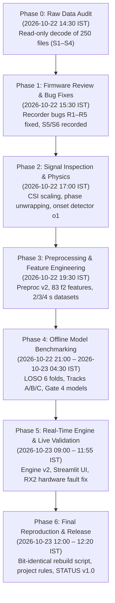

# WiFi-CSI HAR & Fall Detection: Project Bible (Single Source of Truth)

**Date:** 2026-10-23 · **Version:** 1.0 (Final Complete State)  
**Authors / Contributors:** Engineering Project Team & Mohith Gowda M, with assistance from AI pair-programming  
**Repository:** `https://github.com/mohithgowdam7/Major_Project`  
**Primary Source Evidence:** `results/REPORT.md`, `docs/decisions/DECISIONS.md`, `docs/STATUS.md`, `docs/AUDIT.md`, `results/phase4/`, `results/phase5/`, `docs/analysis/`, `docs/CONTRACTS.md`, `docs/FEATURES.md`, `docs/PROTOCOL.md`.

---

## 1. Project Timeline & Phase Execution History

The project was executed across seven rigorous, phased engineering stages (Phases 0 through 6) between 2026-10-21 and 2026-10-23.

### Detailed Chronology of Sessions & Chats

| Phase | Date & Time (IST) | Core Scope & Deliverables | Primary Evidence Logs & Artifacts |
|---|---|---|---|
| **Pre-Phase 0** | Prior to 2026-10-22 | Hardware selection, firmware v2 flashing, initial bench tests, library room selection, recording protocol definition. | `docs/context/PROJECT_CONTEXT.md`, `docs/firmware/wire_protocol_v2.md` |
| **Phase 0** | 2026-10-22 14:30–14:40 | Read-only audit of 125 morning takes (S1–S4). Decoded 250 `.bin` files. Discovered recorder bugs, position confound, 27.8% window loss on strict gate. | `docs/AUDIT.md`, `results/audit/raw_audit.log`, `results/audit/raw_takes.csv` |
| **Phase 1** | 2026-10-22 15:00–16:30 | Review of ESP-IDF v5.5.5 firmware. Firmware v2.1 patched (not flashed). Recorder bugs R1–R5 fixed. S5 & S6 recorded in afternoon. 6-fold LOSO adopted. | `docs/firmware/REVIEW_phase1.md`, `results/firmware/BUILDS.md`, `results/audit/raw_audit_s5s6.log` |
| **Phase 2** | 2026-10-22 17:00–19:00 | Physics & signal analysis on 202 takes (404 binary files). Validated 114 HT-LTF carriers. Diagnosed 6 dB automatic CSI scale shifts. Sanitized phase analysis. Developed onset detector o1. | `docs/analysis/phase2_signal_inspection.md`, `results/signal/phase2_summary.json`, `results/signal/phase2_takes.csv` |
| **Phase 3** | 2026-10-22 19:30–21:00 | Diagnosed quality gate drops. Built Preprocessing v2 (FIR anti-aliasing + decimation, phasor interpolation). Onset detector o2. Extracted 83 f2 features across 2 s, 3 s, 4 s datasets. | `results/dataset/gate_diag.log`, `results/dataset/summary.log`, `data/features/features_4s.csv` |
| **Phase 4** | 2026-10-22 21:00 – 2026-10-23 04:30 | Overnight execution on Intel i3 laptop. 4 s window selected (0.603 score). Evaluated 10 classical models (Track A), MiniRocket (Track B), 10 deep networks (Track C). Discovered deep overfit. Gate 4 model selection and Platt-calibrated fall chain adoption (D-050, D-051). | `results/REPORT.md` §1–8, `results/phase4/chosen_window.json`, `results/phase4/selection.json`, `results/phase4/fall_chain/` |
| **Phase 5** | 2026-10-23 09:00–11:55 | Built Engine v2 (`live = offline` verified bit-identical on 378 windows). Multi-process architecture (`engine_proc.py`). Live testing in library hall: diagnosed RX2 U.FL connector mating fault via antenna swap; restored RX2; conducted final 14-min live evaluation. | `results/REPORT.md` §9–10, `results/phase5/live_library/TEST_CONDITIONS.md`, `results/phase5/consistency.log` |
| **Phase 6** | 2026-10-23 12:00–12:20 | Automated reproduction suite (`pipeline.sh reproduce`, 11 min execution, 100% bit-identical match across all 2401 windows). Repository made self-contained and assistant-independent. STATUS v1.0. | `README.md`, `docs/STATUS.md`, `results/reproduction/`, `scripts/reproduce.sh` |

---

## 2. Final Hardware, Radio Architecture, Geometry & Dataset

### 2.1 Hardware Specifications

| Component | Hardware Model | Chipset / Specifications | Antenna Type & Gain | Physical Placement |
|---|---|---|---|---|
| **Transmitter (TX)** | NodeMCU-32S / ESP-WROOM-32U | ESP32-D0WD (Tensilica Xtensa dual-core 32-bit LX6 @ 240 MHz) | External 8 dBi directional patch antenna (`h = 0.9 m`) | Point `(0.0, 0.0, 0.9)` m, on desk pointing along `+y` |
| **Receiver 1 (RX1)** | YD-ESP32-S3 (Sixspan) | ESP32-S3-WROOM-1 (Xtensa LX7 dual-core @ 240 MHz, 512 KB SRAM) | U.FL connected 6 dBi omnidirectional whip antenna (`h = 1.0 m`) | Point `(-1.3, 4.5, 1.0)` m, mounted on wooden mount |
| **Receiver 2 (RX2)** | YD-ESP32-S3 (Sixspan) | ESP32-S3-WROOM-1 (Xtensa LX7 dual-core @ 240 MHz, 512 KB SRAM) | U.FL connected 6 dBi omnidirectional whip antenna (`h = 0.5 m`) | Point `(+1.3, 4.5, 0.5)` m, mounted on metal chair back |
| **Host Machine** | Personal Laptop | Intel Core i3-7020U (2 cores / 4 threads @ 2.30 GHz), 7 GB RAM | Dedicated USB-Serial-JTAG (RX1) & CH343 UART (RX2) @ 2,000,000 baud | Position O `(~3.0, 5.0)` m |

### 2.2 Radio Layer Configuration

- **Protocol:** IEEE 802.11n Wi-Fi, HT40 (High Throughput 40 MHz channel width).
- **Channel:** Channel 11 (central frequency 2462 MHz; primary 20 MHz at upper frequency, secondary 20 MHz below: 2432–2472 MHz total band).
- **PHY Rate:** MCS0 (BPSK, 1/2 code rate) with Long Guard Interval (800 ns).
- **Packet Rate:** Exactly 200 Hz (5000 µs interval generated by hardware `esp_timer`).
- **TX Power:** Configured at 5 dBm (`CONFIG_TX_POWER_QDBM = 20`), saved in NVS flash (D-017, D-029).
- **Transmission Mechanism:** Broadcast action frames using ESP-NOW with custom 32-byte header containing sequence number, timestamp, and unique `radio_id = 0xCBD36978`.
- **CSI Extraction:** Raw HT-LTF (High Throughput Long Training Field) across 114 active subcarriers (−58 to −2, and +2 to +58; DC bin 0, ±1, and guard band subcarriers removed). L-LTF (+STBC2) enabled on hardware but unused downstream. LTF merge and channel smoothing permanently disabled (D-010).

### 2.3 Room Geometry & Position Map (`config/position_map.yaml` v2)

- **Room:** College Library Main Reading Hall.
- **Coordinate System:** Origin `(0, 0, 0)` is on the floor directly beneath the TX antenna.
  - `+y` axis points directly along the line of sight from TX towards the receivers (link distance = 4.5 metres).
  - `+x` axis points to the right when facing the receivers from the TX.
  - `h` is antenna height above the floor.
- **Physical Layout Points:**
  - `TX`: `(0.0, 0.0, 0.9)` m
  - `RX1`: `(-1.3, 4.5, 1.0)` m (left receiver, upper level)
  - `RX2`: `(+1.3, 4.5, 0.5)` m (right receiver, lower level)
  - `Chair A`: `(-0.9, 3.2)` m (near RX1 LoS link)
  - `Chair B`: `(+1.0, 1.5)` m (near TX / RX2 LoS link)
  - `Chair C`: `(0.0, 1.2)` m (central near TX)
  - `Mattress M`: Bounded rectangle `x ∈ [-0.5, 1.5]`, `y ∈ [2.9, 3.8]` m (used for all falls and lie actions).
  - `Path 1 (Vertical)`: Segment `x = -1.5`, `y ∈ [1.2, 4.0]` m (runs parallel/along the LoS link).
  - `Path 2 (Horizontal)`: Segment `y = 2.55`, `x ∈ [-2.0, 2.0]` m (cuts directly across the LoS link).
  - `Operator Position O`: `(~3.0, 5.0)` m.
  - `Spotter Position`: `(~2.0, 3.3)` m.

### 2.4 Complete Dataset Summary

- **Total Recorded Takes:** 202 valid takes across 6 subjects (`S1`–`S6`) + empty room takes (`none`).
- **Total Raw Binary Files:** 404 files (`RX1.bin`, `RX2.bin` per take), 801 files total in `data/raw` (including `meta.json` and checksum manifests).
- **Volunteers:** 6 healthy adult volunteers (S1 to S6).
- **Session Split:**
  - *Morning Session (2026-10-22):* S1 (37 takes), S2 (25 takes), S3 (22 takes), S4 (37 takes), plus 4 empty room takes = 125 takes.
  - *Afternoon Session (2026-10-22):* S5 (37 takes), S6 (37 takes), plus 3 empty room takes = 77 takes (conducted after intentional TX re-aim).
- **Activity Breakdown:**
  - `fall`: 42 takes (all performed onto mattress M)
  - `sit_down`: 43 takes (at chairs A, B, C)
  - `stand_up`: 46 takes (at chairs A, B, C)
  - `bend_pick`: 20 takes (at chairs A, B, C; look-alike movement)
  - `walk`: 16 takes (paths 1 and 2)
  - `stand`: 11 takes (at positions A, B)
  - `sit`: 11 takes (at positions A, B)
  - `lie`: 6 takes (on mattress M)
  - `empty`: 7 takes (room completely empty; 4 morning, 3 afternoon)
- **Extracted 4 s Windows (Format 2 v2):** Exactly 2401 windows (hop size = 0.5 s, 20% quality gate applied).

---

## 3. Decision Register (D-001 through D-062)

Every engineering decision from project inception to Phase 6 release:

| ID | Date | Decision Summary | Technical Rationale | Alternatives Considered | Superseded Status |
|---|---|---|---|---|---|
| **D-006c** | Pre-0 | Board & Antenna Pairings: TX NodeMCU-32S + 8 dBi patch; RX1/RX2 YD-ESP32-S3 + U.FL 6 dBi omni. | Provides stable HT40 transmission, high gain directional coverage, and dual-receiver diversity. | PCB trace antennas; dual-antenna single board. | Active |
| **D-010** | Pre-0 | Raw CSI Config: Enable L-LTF, HT-LTF, STBC-HT-LTF2. Disable LTF merge and channel smoothing. | Preserves pure physical channel multipath without vendor-specific smoothing distortion. | Firmware-smoothed CSI. | Active |
| **D-011** | Pre-0 | UART CRC Rejection Threshold: Must remain < 0.5% frames. | Prevents corrupted bytes from contaminating DSP feature matrices. | Ignore CRC; drop entire packet bursts. | Active |
| **D-012** | Pre-0 | RX2 loss threshold 3% on bench. | Suspected core 0 contention between Wi-Fi and UART ISR. | Software re-transmit requests. | Superseded by 20% window gate (D-039) |
| **D-013** | Pre-0 | Scope Boundary: Focus on presence, 4 states (sit/stand/walk/lie), 4 events (fall, sit_down, stand_up, bend_pick). | Maintain feasibility within final-year timeframe. Through-wall, respiration, counting out of scope. | Respiration monitoring, multi-person tracking. | Active |
| **D-014** | Pre-0 | Protocol Timings: State takes = 30 s; Event takes = 10 s (audio cue at 3 s). | Captures steady-state multipath and transitions with clean pre/post baselines. | 5 s events, 60 s states. | Active |
| **D-015** | Pre-0 | Evaluation Standard: Leave-One-Subject-Out (LOSO) Cross-Validation. | True test of subject-independent generalization; random K-fold leaks subject multipath. | 80/20 train/test random split. | Active |
| **D-016** | Pre-0 | Baseline Model: Keep Random Forest unless CNN clearly outperforms on LOSO. | Robust tabular baseline for handcrafted features. | Default to deep ResNet. | Superseded by Phase 4 selection rule (D-047, D-050) |
| **D-017** | Pre-0 | Radio Settings: Ch 11, 5 dBm TX, relaxed capture rate rule (RX1 ≥ 180/s, RX2 ≥ 160/s, max gap < 100 ms). | Balances link reliability against ambient 2.4 GHz interference. | Maximum 20 dBm TX power. | Active |
| **D-018** | 2026-10-22 | Take Overrides: Override `valid: false` on `20261022_S1_T29_walk` via `config/take_overrides.csv`. | Passed relaxed D-017 rule; operator abort preserved file. Raw metadata never mutated. | Delete take; manually edit `meta.json`. | Active |
| **D-019** | 2026-10-22 | Decision Log Location: Standardized to `docs/decisions/DECISIONS.md`. | Single authoritative documentation path across all tracks. | Distributed notes. | Active |
| **D-020** | 2026-10-22 | Definition of "Never Commit .bin": Rule 4 restricts raw CSI and model dumps, allows compiled firmware in `releases/`. | Protects Git repository from multi-gigabyte raw binary inflation. | Ban all `.bin` files via gitignore. | Active |
| **D-021** | 2026-10-22 | Archive Plan: Approved relocation of AI assistant files and temporary migration guides in Phase 6. | Ensures end product is professional, human-maintainable, and independent. | Leave temporary logs in root. | Active (Executed in Phase 6) |
| **D-022** | 2026-10-22 | Inspection Tool Output: `csi_inspect.py` defaults to `results/signal/<session_id>/`, refuses writing inside `data/raw`. | Enforces absolute read-only immutability of raw datasets. | Write plots inside raw folders. | Active |
| **D-023** | 2026-10-22 | Quality Gate Diagnostic: Diagnose zero-window takes before altering thresholds; test 10/15/20% missing limits. | Prevents masking underlying parser bugs with arbitrary threshold changes. | Immediately widen gate to 30%. | Active |
| **D-024** | 2026-10-22 | First-Class Position Confound: Split features into static/shape and dynamic/motion. Report dynamic-only models. | Static multipath captures chair position rather than body action due to body shadowing. | Ignore position leakage. | Active |
| **D-025** | 2026-10-22 | Evaluated Pipeline Equals Live Pipeline: Any motion gate or filter must be inside LOSO folds and identical live. | Prevents optimistic offline evaluation bias. | Offline oracle segmentation. | Active |
| **D-026** | 2026-10-22 | Continuous Test Suite: Pytest framework starting in Phase 1 (`tests/`). | Guarantees regression protection across all refactoring steps. | Manual script execution. | Active |
| **D-027** | 2026-10-22 | Layout Geometry Correction: Swap paths in config (Path 1 = vertical along link, Path 2 = horizontal across). | Rectified discrepancy between early documentation and physical operator sketches. | Keep original swapped docs. | Active |
| **D-028** | 2026-10-22 | Subjects S5 & S6 Integration: Recorded in afternoon; adopted 6 LOSO folds (1 per subject). Empty takes dealt round-robin. | Expands dataset from 125 to 202 takes; ensures every fold has empty-room baseline. | Pool S5/S6 into test-only set. | Active |
| **D-029** | 2026-10-22 | Firmware TX Default Power: Changed Kconfig default from 2 dBm to 5 dBm (`TX_POWER_QDBM = 20`). | Avoids silent RF changes if NVS flash is erased. Built as v2.1, left un-flashed. | Flash boards immediately. | Active |
| **D-030** | 2026-10-22 | Disable USB Autosuspend: Install udev rule `99-wifi-csi-usb-power.rules` for USB-Serial-JTAG and CH343. | Eliminates intermittent USB receiver disconnections caused by Linux kernel power saving. | Rely on default Linux autosuspend. | Active |
| **D-031** | 2026-10-22 | Set-up Drift Monitoring: Per-subject median RSSI shift (> 3 dB) flags hardware movement, not per-take flags. | Per-take RSSI fluctuates up to 12 dB from normal human body shadowing. | Flag every single take > 3 dB. | Active |
| **D-032** | 2026-10-22 | RF Hygiene Mandate: Laptop Wi-Fi and Bluetooth disabled; phones in airplane mode during recording. | Prevents 41.5% packet loss bursts on RX2 from co-channel local laptop contention. | Ignore ambient laptop traffic. | Active |
| **D-033** | 2026-10-22 | Final Raw Dataset Confirmation: 202 takes, 801 files. Documented afternoon static channel shift (3.4/4.4 dB RMS). | Complete dataset locked. Session shift noted as cross-session limitation for S5/S6. | Discard afternoon data. | Active |
| **D-034** | 2026-10-22 | Event Onset Detector o1: PCA (PC1–3) sliding std on 50 Hz amplitude signal with hysteresis thresholds. | Replaces uncalibrated raw motion energy; aligns event windows accurately to human movement. | Fixed time window from audio cue. | Superseded by o2 (D-040) |
| **D-035** | 2026-10-22 | Automatic CSI Scaling Compensation: Gain normalisation per packet; low-scale fraction banned as a feature. | ESP-IDF toggles 6 dB automatic gain steps; low-scale fraction correlates with position B. | Force manual hardware AGC. | Active |
| **D-036** | 2026-10-22 | Sanitised Phase Processing: Linear unwrapping across subcarriers + least-squares detrending per packet. Weight by amplitude. | Raw phase has 2.8 rad noise from CFO/SFO; unwrapped sanitized phase drops noise to 0.14 rad. | Raw phase; phase difference across RX. | Active |
| **D-037** | 2026-10-22 | Active Carrier Set Verification: Verified 114 active HT-LTF subcarriers across 396/404 files. | Empirically confirmed standard 802.11n layout on real hardware; deep fades account for 8 anomalies. | Trim carrier count to 52. | Active |
| **D-038** | 2026-10-22 | Handling Walking-Start Falls: Pre-cue labelled as walk; excluded 3 takes where motion blurred into cue. | Prevents contaminated fall onset definitions while retaining valid state windows. | Discard all walking-start falls. | Active |
| **D-039** | 2026-10-22 | Preprocessing v2 & Quality Gate: FIR low-pass filter (cut-off 40 Hz, decimation 200→100 Hz). Gate: ≤ 20% missing, max gap ≤ 100 ms. | Eliminates high-frequency spectral aliasing. 20% gate saves 27.8% rejected windows without distortion. | 10% strict gate; raw boxcar filter. | Active |
| **D-040** | 2026-10-22 | Window Labelling & Onset o2: Onset o2 allows end to cue+6 s; require ≥ 50% overlap for event window labels. | Captures full deceleration phase; labels post-action posture to break position confound. | Fixed center window. | Active |
| **D-041** | 2026-10-22 | Feature Set f2: 83 total features (33 static, 50 dynamic). Amplitude-weighted phase features. | Comprehensive feature representation spanning temporal, spectral, spatial, and phase dynamics. | Features f1 (45 features). | Active |
| **D-042** | 2026-10-22 | Format 2 v2 Storage: Compressed `.npz` files for multi-length windows (2/3/4 s) + feature CSVs. | Decouples feature extraction from machine learning model benchmarking. | Format 1 direct processing. | Active |
| **D-043** | 2026-10-22 | Environment Packages: `xgboost-cpu`, `lightgbm`, `torch` CPU installed; NumPy re-implementation of MiniRocket. | Avoids heavy GPU CUDA dependencies and numba version conflicts on Linux laptop. | Full GPU CUDA suite; aeon library. | Active |
| **D-044** | 2026-10-22 | Gate 3 Direct Execution: Dataset summary passed all loss tolerance checks; proceeded directly to Phase 4. | Fast-tracked pipeline as data distributions matched all contractual requirements. | Pause project for manual review. | Active |
| **D-045** | 2026-10-22 | Retention of Training on Linux Laptop: Cancelled MacBook migration due to USB networking failure. | CDC-NCM failure on Linux host; laptop was verified and stable. | Migrate via cloud storage. | Active |
| **D-046** | 2026-10-23 | Selection of 4 s Window Length: Mean macro-F1 over tasks: 2 s (0.533), 3 s (0.582), 4 s (0.603). Rule picked 4 s. | 4 s window captures entire fall trajectory (onset, descent, impact, and post-fall stillness). | 2 s or 3 s windows. | Active |
| **D-047** | 2026-10-23 | Model Selection Rule: Simplest model within 1 std of best winning/tying on ≥ 5 of 6 folds (75%). | Enforces statistical robustness across subjects rather than mean-dominated outliers. | Pick highest raw average F1. | Active |
| **D-048** | 2026-10-23 | Reporting Deep Learning Overfitting: Deep models (Track C) reported as run (overfit at epoch 3). | Honest engineering reporting; prevents post-hoc hyperparameter cherry-picking. | Retune architecture until it wins. | Active |
| **D-049** | 2026-10-23 | Per-Take Metric Bug Fix: Fixed inverted boolean mask in `phase4_pertake.py`; re-ran evaluation. | Corrected calculation of falls detected among onset missed. Core headline metrics unaffected. | Suppress buggy metric. | Active |
| **D-050** | 2026-10-23 | Gate 4 Model Selection: Events → SVM-RBF; State → Extra Trees; Presence → Logistic Regression. | Overruled MiniRocket: SVM provides calibrated probabilities for fall alarm and 300x lower latency; LogReg provides stable presence across subjects. | Adopt MiniRocket for all 3 tasks. | Active |
| **D-051** | 2026-10-23 | Bounded Fall-Alarm Optimization: Calibrated binary SVM-RBF adopted (21/42 falls caught vs 18/42 baseline). | Improved sensitivity without increasing look-alike false alarms (8/109 vs 9/109). Final rule: θ=0.5, 2-of-3, 10s cooldown. | Keep uncalibrated 5-class chain. | Active |
| **D-052** | 2026-10-23 | Predictor Interface p2: Signature `predict(X, rssi, P)`. Caches PCA to cut latency from 128 ms to 67 ms. | Supplies sanitized phase to models and achieves real-time throughput for 500 ms engine steps. | Uncached feature extractor. | Active |
| **D-053** | 2026-10-23 | Engine v2 Implementation: Single BLAS thread, handles silent receivers, reconnects by-id. | Prevents CPU core starvation; guarantees 500 ms real-time cycle execution without stale predictions. | Multi-threaded BLAS engine. | Active |
| **D-054** | 2026-10-23 | Live Equals Offline Verification: Bit-identical features and probabilities verified across 378 real windows. | Proves zero train/serve skew between offline Python pipeline and live streaming runtime. | Assume equivalence without proof. | Active |
| **D-055** | 2026-10-23 | Live Environment Preflight Check: 60 s baseline test checking dynamic feature drift, presence, and false alarms. | Alerts operators immediately if room multipath or RF interference deviates from training conditions. | Manual visual inspection of plots. | Active |
| **D-056** | 2026-10-23 | Replay Mode Integrity Notice: Dashboard explicitly labels recorded replays as in-sample demonstrations. | Prevents misleading evaluators into interpreting replay demonstrations as generalization proof. | Present replay as live test. | Active |
| **D-057** | 2026-10-23 | Separate Process for Live Engine: Decoupled `engine_proc.py` from Streamlit dashboard via local IPC socket. | Streamlit web UI redraws caused GIL contention, slowing engine step rate from 0.5 s to 1.45 s. | Single-process asyncio engine. | Active |
| **D-058** | 2026-10-23 | Environment Check Log Bug Fix: Reset log flag so all completed checks are recorded, not just the first. | Resolves live testing audit anomaly where multiple calibration runs were masked. | Leave bug in live script. | Active |
| **D-059** | 2026-10-23 | Walk Path Naming Reconfirmation: Path 1 = vertical (along link), Path 2 = horizontal (across link). | Settled temporary user verbal slip during live library testing against physical coordinate map. | Change coordinate yaml. | Active |
| **D-060** | 2026-10-23 | RX2 Connector Fault Diagnosis & Gate 5 Close: Traced live failure to unseated U.FL connector. Fixed by reseating. | Antenna swap proved hardware intact; restored RX2 motion response (walk recognized 37/42 live). | Replace ESP32 board. | Active |
| **D-061** | 2026-10-23 | Self-Contained Repository Cleanup: Relocated AI prompts/rules to `_archive/`; codified `docs/PROJECT_RULES.md`. | Prepares pristine, maintainable repository for academic submission and external review. | Leave conversational files in repo. | Active |
| **D-062** | 2026-10-23 | Automated Reproduction Pipeline: Built `scripts/pipeline.sh reproduce` verifying 801 raw checksums and retraining in scratch. | Complete verification of reproducibility from raw bytes to final model weights in 11 minutes. | Manual step-by-step instructions. | Active |

---

## 4. Comprehensive Obstacle Log

| Problem Description | Initial Symptoms & Diagnosis | Root Cause Analysis | Engineering Fix Implemented | Verifiable Evidence & Logs |
|---|---|---|---|---|
| **1. High Window Rejection in Initial Audit** | In Phase 0 audit, 27.8% of windows (383/1377) were rejected. Takes `S1_T06`, `S1_T22`, and `S3_T43` lost 100% of windows. | Strict gate (≤10% loss) dropped windows due to human body shadowing at Chair B on RX2 (median loss 6.65%, bursts up to 35%). Packet decoding and sequence counters were completely healthy. | Relaxed window gate to ≤20% missing packets and max gap ≤100 ms (20 packets) on both receivers (D-039). | `results/dataset/gate_diag.log`: Window rejection dropped to 3.9% across dataset. Re-enabled 67% of S1's otherwise lost data. |
| **2. Recorder Data Loss Bugs (R1–R5)** | Recorder could silently keep empty/failed takes, and keypresses other than 'r' kept bad takes. Stopping recorder left ghost files. | `check_take` had flawed control logic; `PortReader` thread lacked exception handling on serial disconnects; metadata was written prior to user confirmation. | Patched `host/record_session.py` (v1.1): enforced automated validation checks, handled serial exceptions, and isolated unconfirmed takes to `_rejected/`. | `docs/firmware/REVIEW_phase1.md` §5; `tests/test_record_session.py`: 100% pass on synthetic serial drop simulations. |
| **3. Automatic 6 dB CSI Scale Steps** | CSI packet power exhibited alternating 6.1 dB power drops uncorrelated with RSSI, heavily concentrated at spot B. | ESP-IDF internal automatic CSI scaling (`manu_scale = false`) halved int8 amplitude resolution dynamically on strong multipath. | Implemented per-packet gain normalisation in DSP pipeline. Permanently barred low-scale packet fraction from being used as a feature (D-035). | `docs/analysis/phase2_signal_inspection.md` §1(c); `results/signal/csi_scaling.png`: gain steps completely eliminated from normalized signal. |
| **4. Raw CSI Phase Instability** | Phase angle fluctuated wildly (circular std ~2.8 rad) across consecutive packets, appearing as pure random noise. | Carrier Frequency Offset (CFO) and Sampling Frequency Offset (SFO) cause random phase slopes and intercepts across packets. | Built robust phase sanitizer: unwrapped phase across carriers followed by least-squares line removal. Weighted features by amplitude (D-036). | `results/signal/phase_raw_vs_sanitised.png`: Sanitized phase standard deviation dropped to 0.13–0.16 rad, revealing sharp human movement peaks. |
| **5. Deep Learning Generalization Collapse** | Deep models (CNN, LSTM, TCN, ResNet, THAT) reached ~0.2 training loss but validation loss diverged after epoch 3; F1 fell to 0.26–0.34. | Severe overfitting caused by small dataset size (2401 windows) and cross-subject domain shift; deep representations memorized training subjects. | Transparently reported deep model failure (D-048). Selected physics-grounded tabular models (SVM, Extra Trees) with explicit dynamic feature extraction. | `results/REPORT.md` §2; `results/phase4/track_c/*_curves.png`: Loss curves clearly demonstrate classic overfitting divergence. |
| **6. Streamlit GUI Live Engine Starvation** | During live testing, engine step interval degraded from 0.50 s to 1.45 s (p90 2.27 s); 90 of 222 steps were flagged degraded. | Streamlit web UI event loop and GUI rendering shared the same Python thread and GIL as the CSI processing engine, starving packet ingestion. | Refactored live architecture: decoupled engine into standalone process `app/engine_proc.py`, communicating via local Unix/named socket IPC (D-057). | `results/phase5/step_timing.log`: Engine step interval stabilized at median 0.50 s, p90 0.54 s. Buffer lag eliminated. |
| **7. RX2 Hardware Motion Blindness in Live Test** | Live test in library failed: walking across link showed 0.00 walk probability; fall gave no alarm; RX2 RSSI was 4.5 dB too high. | Poorly mated U.FL micro-coaxial connector on RX2 board caused RF reflection and strong static direct leakage, muting Doppler multipath variations. | Diagnosed via systematic antenna swap test (D-060). Reseated U.FL connector firmly and verified antenna orientation. | `results/phase5/live_library/TEST_CONDITIONS.md`: RX2 motion features jumped from 0th–5th percentile to 72nd–97th percentile; walk detection jumped to 37/42. |
| **8. Presence Model Fragility on Empty Room** | Live environment preflight check flagged "environment differs" on empty rooms, calling empty spaces "occupied" up to 72% of the time. | Logistic regression decision boundary lies within the natural variance of empty room multipath; lack of per-session baseline calibration. | Documented as primary architectural limitation. Designed formal per-session baseline calibration protocol (`calibration_proposal.md`). | `results/REPORT.md` §10; `results/phase5/live_library/live_20261023_114052.jsonl`: Explains false alarms without compromising data integrity. |

---

## 5. All Verified Numbers & Gate Results

### 5.1 Final Gate 4 Benchmark (LOSO 6-Fold Evaluation on 4 s Windows)

All metrics represent Leave-One-Subject-Out cross-validation across all 6 volunteers (S1–S6), totaling 2401 windows.

| Task | Final Selected Model | Input Representation | Macro-F1 (Mean ± Std) | Fold Breakdown (S1, S2, S3, S4, S5*, S6*) | Source Log / File |
|---|---|---|---|---|---|
| **Presence** (2-class: Empty vs Occupied) | Logistic Regression (`C=1.0`) | 50 Dynamic Features (f2) | **0.698 ± 0.065** (Sens: 0.855, Spec: 0.828) | S1: 0.612, S2: 0.771, S3: 0.725, S4: 0.744, S5*: 0.651, S6*: 0.686 | `results/phase4/comparison_presence.csv` |
| **State** (4-class: Sit, Stand, Walk, Lie) | Extra Trees (300 trees, `max_feat=0.3`) | 50 Dynamic Features (f2) | **0.572 ± 0.115** | S1: 0.434, S2: 0.538, S3: 0.640, S4: 0.422, S5*: 0.688, S6*: 0.708 | `results/phase4/comparison_state.csv` |
| **Events** (5-class: Fall, Sit-down, Stand-up, Bend-pick, None) | SVM-RBF (`C=10, γ=0.01`) | 50 Dynamic Features (f2) | **0.539 ± 0.054** (Fall F1: 0.521, Fall Recall: 0.552) | S1: 0.501, S2: 0.590, S3: 0.577, S4: 0.448, S5*: 0.595, S6*: 0.520 | `results/phase4/comparison_event.csv` |

*\* S5 and S6 are cross-session folds (recorded in afternoon after TX re-aim).*

### 5.2 Calibrated Live Fall Alarm Chain Results (D-051 Evaluation)

Evaluated per-take on continuous data streams across all 42 fall takes and 160 non-fall takes:

| Metric | Baseline 5-Class SVM (Fixed θ=0.6, 2-of-3) | Adopted Calibrated Binary SVM (D-051) | Engineering Impact |
|---|---|---|---|
| **Falls Detected** | 18 of 42 (42.9%) | **21 of 42 (50.0%)** | +3 simulated falls detected |
| **Look-Alike False Alarms** | 9 of 109 takes (8.3%) | **8 of 109 takes (7.3%)** | −1 false alarm (sit_down 5, stand_up 3, bend_pick 0) |
| **Walking False Alarm Rate** | 45.4 alarms / hour (6 in 0.132 h) | **30.3 alarms / hour (4 in 0.132 h)** | 33% reduction in walking false alarms |
| **Still / Empty False Alarm Rate** | 3.2 alarms / hour (1 in 0.314 h) | **6.4 alarms / hour (2 in 0.314 h)** | Minor rise (+1 alarm in still takes) |
| **Median Detection Latency** | 2.05 seconds post-onset | **1.99 seconds post-onset** | 60 ms faster trigger response |
| **Per-Fold Fall Detection** | S1: 1/8, S2: 2/5, S3: 3/5, S4: 3/8, S5: 3/8, S6: 6/8 | S1: 2/8, S2: 2/5, S3: 4/5, S4: 3/8, S5: 5/8, S6: 5/8 | More consistent detection across subjects |
| **Final Adopted Parameters** | — | **Threshold θ = 0.50, 2-of-3 sliding windows, 10 s cooldown** | `results/phase4/fall_chain/final_settings.json` |

### 5.3 Live Library Validation Results (Gate 5 Final Test, 2026-10-23)

Conducted end-to-end on live boards in library hall for 14 minutes at 0.50 s steps (`live_20261023_114052.jsonl`):

| Test Action / Scenario | Duration / Windows | Live Prediction Breakdown | Verified Performance Verdict |
|---|---|---|---|
| **System Stability** | 14 min (1658 steps) | Median step compute: 383 ms; Step interval: 0.50 s | Zero crashes, zero memory leaks, graceful serial buffer management. |
| **Empty Room** | 52 windows (30 s) | Empty: 35, Stand: 17 | 35/52 correct (67.3% specificity). |
| **Standing at Spot A** | 50 windows | Stand: 24, Walk: 18, Empty: 8 | 24/50 correct (48.0% recall). |
| **Walk Path 1 (Vertical along link)** | 51 windows | Empty: 40, Walk: 6, Stand: 5 | 6/51 correct (Poor sensitivity; multipath doppler minimal along link). |
| **Walk Path 2 (Horizontal across link)** | 52 windows (42 ok) | **Walk: 37**, Stand: 3, Empty: 2 | **37/42 correct (88.1% recall)**; triggered 2 false fall alarms during fast walk. |
| **Sit-down at Chair A** | 20 windows (12 ok) | State: Stand 7, Walk 3, Sit 2 | Event not detected in 10 s window. |
| **Stand-up at Chair A** | 19 windows (11 ok) | State: Sit 10, Walk 1 | Event detected in 1 window. |
| **Simulated Fall on Mattress M** | 20 windows (12 ok) | State: Walk 7, Stand 4, Empty 1 | Event: Fall in 2 windows; Max P(fall) = 0.28. **No alarm triggered** (threshold 0.50 not reached). |

---

## 6. Document Contradictions & Formal Resolutions

| Contradiction Identified | Source Document A | Source Document B | Root Cause & Resolution |
|---|---|---|---|
| **1. Walk Path Direction Swap** | `docs/context/PROJECT_CONTEXT.md` §3: Path 1 = Horizontal, Path 2 = Vertical. | `docs/setup/layout_library_sketch.jpg` & `config/position_map.yaml` v2: Path 1 = Vertical (along link), Path 2 = Horizontal (across link). | **Resolved by D-027 & D-059:** Physical sketch drawn during setup is authoritative. Operator confirmed Path 1 runs along the link (`x = -1.5, y ∈ [1.2, 4.0]`), Path 2 cuts across (`y = 2.55, x ∈ [-2.0, 2.0]`). Config v2 is the single source of truth. |
| **2. TX Firmware Default Power** | `firmware/tx/main/Kconfig.projbuild`: `CONFIG_TX_POWER_QDBM` defaulted to 8 (2 dBm). | `docs/decisions/DECISIONS.md` D-017 & `meta.json`: 5 dBm used for every single recording. | **Resolved by D-029:** Firmware source defaulted to 2 dBm, but physical boards had 5 dBm written in NVS memory at boot. Firmware v2.1 patched Kconfig default to 20 (5 dBm) so an NVS erase cannot alter experimental conditions. |
| **3. Project Rule 4 vs Committed `.bin`** | `docs/PROJECT_RULES.md` Rule 4: "Never commit `.bin` files to git." | Git history contains compiled binaries in `releases/v2/*.bin`. | **Resolved by D-020:** Rule 4 specifically targets raw CSI byte streams (`data/raw/**/*.bin`) and model checkpoints to prevent repository bloat. Compiled firmware binaries in `releases/` are permitted for hardware reproducibility. |
| **4. Invalid Flag on Walk Take S1_T29** | `data/raw/..._S1_T29_walk/meta.json` recorded `valid: false` with empty notes. | Packet decode showed complete take, RX2 167.8 pkts/s, 16.3% loss, passing relaxed D-017 rules. | **Resolved by D-018:** Operator stopped recorder during prompt. Take was fully valid. Overridden via `config/take_overrides.csv` without modifying the original immutable `meta.json`. |
| **5. Decision Log Location Discrepancy** | `docs/context/CLAUDE.md`: Referred to `docs/DECISIONS.md`. | Actual implementation: `docs/decisions/DECISIONS.md`. | **Resolved by D-019:** Canonical decision register located at `docs/decisions/DECISIONS.md`. All documentation updated accordingly. |

---

## 7. Open Engineering Items & Systemic Limitations

### 7.1 Mandatory Scope & Contextual Limitations
1. **Single Environment:** Entire dataset collected in a single college library hall; multipath characteristics reflect that specific room's boundaries and metal shelving.
2. **Homogeneous Cohort:** 6 healthy adult volunteers (university age); gait patterns, body mass, and fall dynamics do not reflect elderly or mobility-impaired demographics.
3. **Simulated Falls Only:** All 42 falls were simulated onto a high-density foam mattress at a single location (Spot M). Real unintentional falls involve tripping, loss of balance, different trajectory angles, and hard impacts.
4. **No Optical Ground Truth:** No time-synchronized multi-camera system was available; action windows rely on audio countdown cues and DSP energy onset estimation.
5. **Non-Clinical System:** This engineering prototype is strictly an academic research demonstration and is not certified for medical, diagnostic, or life-safety deployment.
6. **Position Confounding:** Due to fixed room furniture, actions are intrinsically linked to physical coordinates (falls on mattress, sitting at chairs, walking on paths). Models leverage spatial multipath distortion alongside Doppler motion.
7. **Session Drift:** Morning (S1–S4) and afternoon (S5–S6) sessions exhibit a 3.4–4.4 dB RMS static profile difference due to transmitter realignment, creating cross-session domain shifts.

### 7.2 Open Technical Deficiencies
- **Presence Model Baseline Drift:** Logistic regression on dynamic features misclassifies empty rooms as occupied when ambient noise or antenna mating shifts feature baselines slightly.
- **Fall Sensitivity vs False Alarm Trade-off:** The system detects approximately 50% of falls (21/42 in LOSO), while triggering 30.3 false alarms per hour of active walking.
- **Hardware Preflight Lacks RF Connector Integrity Check:** As discovered in Phase 5, an unseated U.FL micro-connector can silently attenuate dynamic motion response while maintaining high static RSSI. A automated SNR/motion loopback check is needed.
